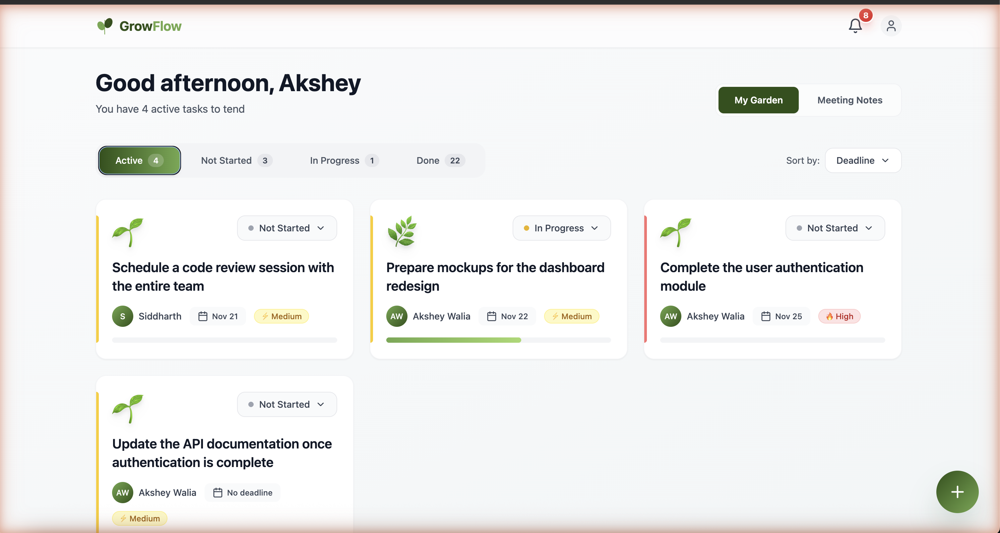
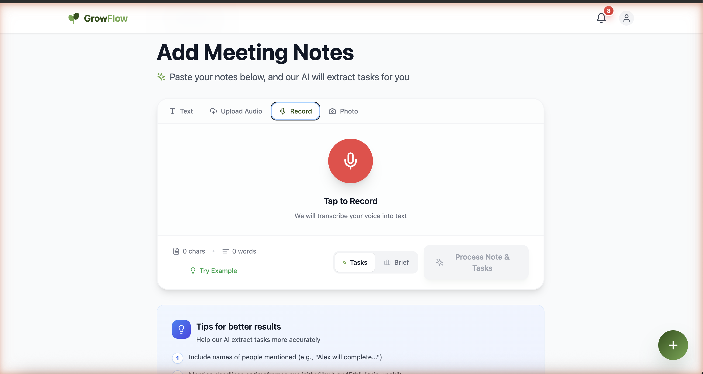
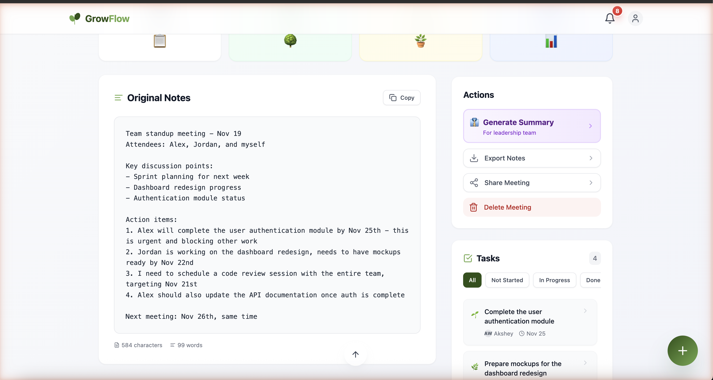
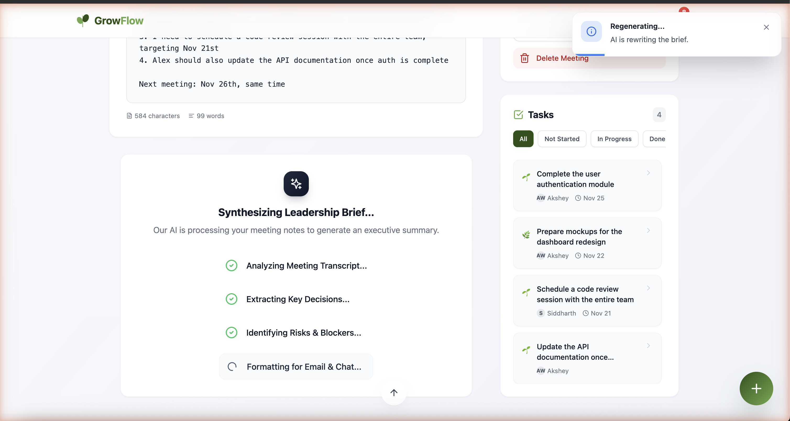
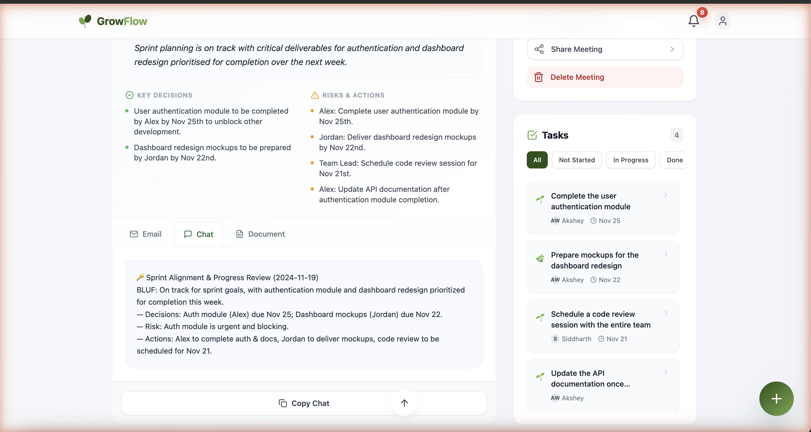

<div align="center">

# 🌱 GrowFlowAI: AI that turns meeting notes into tracked tasks

### Your meeting notes, turned into tasks that grow like plants.

[](https://grow-flow-ai.vercel.app)
[](https://github.com/aksheyw/GrowFlowAI/actions/workflows/ci.yml)
[](LICENSE)

</div>

---

Most of what I agreed to in meetings used to get lost in notes I never re-read, so I built GrowFlowAI. You send it a meeting note (typed, a voice memo or a whiteboard photo) from the web app, email or Telegram (a chat app), and AI pulls out WHO does WHAT by WHEN and saves each one as a task, which is a plant that grows as you finish it. At 9am the Telegram bot sends what's due.

<p align="center">
  
</p>

<p align="center">
  <a href="https://grow-flow-ai.vercel.app">
    
  </a>
  <br>
  <em>The dashboard. Each task grows as you make progress on it.</em>
  <br>
  <a href="https://grow-flow-ai.vercel.app"><b>🚀 Try the live demo →</b></a>
</p>

---

## What makes it different

- ✅ **Lives where you already work:** Telegram-first, no new app to learn. Web + Android are convenience layers.
- ✅ **Zero structured input:** paste a transcript, forward an email, send a voice note. AI figures out the structure.
- ✅ **Plant metaphor with substance:** each task's status (`Not Started → In Progress → Done`) is a growth stage, so progress feels rewarding without being gimmicky.
- ✅ **Opinionated single-user build:** row-level security (RLS, the database enforces who sees what) is already built in.

## What it looks like, step by step

GrowFlowAI turns raw meeting notes, voice memos, and whiteboard photos into tracked tasks. Each step below is a real screenshot from the live app:

**1. Send a note any way you like:** paste, upload, record, or take a photo.

<p align="center">
  
</p>

**2. Your note on the left, the tasks it found on the right.**

<p align="center">
  
</p>

**3. Ask for a leadership brief, and it gets written.**

<p align="center">
  
</p>

**4. A leadership brief, bottom line up front (BLUF):** summary, decisions, risks and actions.

<p align="center">
  
</p>

## Why I built this

I spend most of my day in meetings, and most action items I commit to in those meetings end up forgotten, buried under notes I never re-read. So I wanted a tool that sits inside Telegram where my day already happens, takes whatever I throw at it and works out the structure on its own, and makes the follow-through feel like something worth doing, which is where the growing plants came from.

I built it as a side-project to push myself end-to-end on a real product: web + Android (via Capacitor) + a Telegram bot orchestrated through n8n + AI processing on Supabase Edge Functions.

<details>
<summary>📋 <b>Every way in, and everything it gives back</b></summary>

<br>

| Surface | Input | What happens |
|---------|-------|--------------|
| Telegram text | Plain message | The AI model (LLM) extracts tasks with assignee, deadline, priority |
| Telegram voice | Voice note | Whisper (OpenAI's speech-to-text) transcribes → LLM extracts tasks |
| Telegram photo | Photo of a whiteboard / sticky note | Vision reads the text in the photo (OCR) → LLM extracts tasks |
| Web app | Paste a meeting transcript | Same LLM pipeline; a leadership brief on request |
| Email | Forward to the ingestion inbox | n8n parses → same pipeline |
| Voice rambling | Stream-of-consciousness recording | AI cleans it up, then extracts tasks |

**Output**

- A dashboard of tasks, each rendered as a plant whose growth stage tracks status (`Not Started → In Progress → Done`)
- A meeting note detail page with related tasks and, on request, an exec-style leadership brief (TL;DR + decisions + action items in email/chat/document formats)
- "The Gardener": ask questions about your past notes
- Daily 9am Telegram digest of due/overdue tasks with one-tap `✅ Done` / `⏰ Snooze` / `📅 Tomorrow` buttons
- Google Calendar sync (tasks → calendar events)

</details>

<details>
<summary>🔧 <b>Tech stack</b></summary>

<br>


| Layer | Choice | Why |
|-------|--------|-----|
| Frontend | **React + Vite + TypeScript** | Fast dev loop, type safety, modern build |
| Styling | **Tailwind + Framer Motion** | Utility-first + smooth animations |
| State / data | **TanStack Query + Supabase Realtime** | Server-state + push updates |
| Routing | **react-router** | Explicit routes |
| Mobile | **Capacitor + PWA** (`vite-plugin-pwa`) | One codebase, web + Android |
| Backend | **Supabase** (Auth + Postgres + Edge Functions) | Single platform, RLS, Deno edge runtime |
| AI | **OpenAI**: an LLM, Whisper, and Vision | Task extraction, voice transcription, OCR |
| Automation | **n8n on Hostinger VPS** | Visual flows for Telegram bot + email + cron |
| Quality | **TypeScript strict + ESLint** | Cheap safety net |

</details>

<details>
<summary>📦 <b>Run it yourself</b> (partial setup)</summary>

<br>

> Recruiters: feel free to skip this since the [code](src/), [edge functions](supabase/functions/), and [migrations](supabase/migrations/) are the interesting bits.

**Prerequisites**
- Node 20+
- A Supabase project
- (Optional) OpenAI API key for AI task extraction in the edge function (falls back to a regex parser without it)
- (Optional) An n8n instance + Telegram bot

```bash
# 1. Clone and install
git clone https://github.com/aksheyw/GrowFlowAI.git
cd GrowFlowAI
npm install

# 2. Configure environment
cp .env.example .env
# Edit .env with your Supabase URL + anon key

# 3. Apply database schema (32 migrations)
#    Partial: the migrations do not create the leadership_brief column the app reads,
#    and several migrations are duplicated, so a fresh push needs fixing by hand
npx supabase db push

# 4. Deploy edge functions
npx supabase functions deploy process-ai-notes
npx supabase functions deploy webhook-telegram-note
npx supabase functions deploy update-task-status

# 5. (Optional) Set OpenAI key for the edge function
npx supabase secrets set OPENAI_API_KEY=sk-...

# 6. Run
npm run dev
```

The web app calls my n8n server at fixed addresses for voice, photos, briefs and calendar sync.

For the **Telegram bot** experience, see [`n8n/README.md`](n8n/README.md), which walks through importing the sanitised workflow templates and wiring up your Telegram + Supabase + OpenAI credentials.

For the **Android** build:

```bash
npm run build
npx cap add android        # first time only
npx cap sync android
npx cap open android       # opens Android Studio
```

`capacitor.config.ts` currently points the app at the live demo (`server.url`). Remove that line to run your own build.

</details>

<details>
<summary>📄 <b>Project structure</b></summary>

<br>

```
src/
├── components/        UI components (cards, modals, layout, theme)
│   ├── meeting-note/    Meeting detail UI (summary, tasks, leadership brief)
│   ├── notes/           Note editor + media input (voice / photo)
│   ├── premium/         Premium dashboard widgets
│   ├── task-detail/     Task hero plant + activity timeline
│   └── ui/              Atoms (Button, Card, DatePicker, Select, ...)
├── contexts/          AuthContext, ThemeContext, ToastContext
├── hooks/             React Query hooks (useTasks, useNotifications, ...)
├── lib/               Supabase client, API helpers, type defs
├── pages/             Route components (Dashboard, TaskDetail, AddNote, ...)
├── types/             Shared TypeScript types
└── utils/             Audio compression, premium helpers, text analysis

supabase/
├── functions/         3 Deno edge functions
└── migrations/        32 SQL migrations (schema, RLS policies, indexes)

n8n/                   Telegram bot workflow exports (sanitised)
Docs/                  ROADMAP.md, SKILLS.md
```

</details>

## Status

Personal project. Not multi-tenant yet: single-user model with RLS (row-level security). See [`Docs/ROADMAP.md`](Docs/ROADMAP.md) for what's built vs. what's planned. The product story is in [`CASE-STUDY.md`](CASE-STUDY.md).

## License

[MIT](LICENSE) © 2026 Akshey Walia

---

<div align="center">

**Built by [Akshey Walia](https://www.linkedin.com/in/aksheywalia/)** · [LinkedIn](https://www.linkedin.com/in/aksheywalia/) · [aksheywalia.in](https://aksheywalia.in)

*Senior Product Leader · Consumer Platforms at 250M+ Device Scale · AI Product Building · 0-to-1*

</div>
